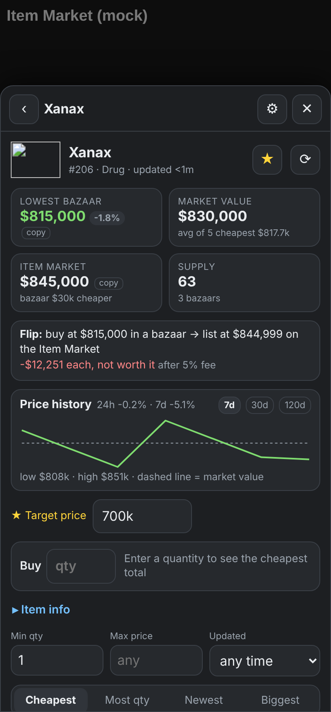
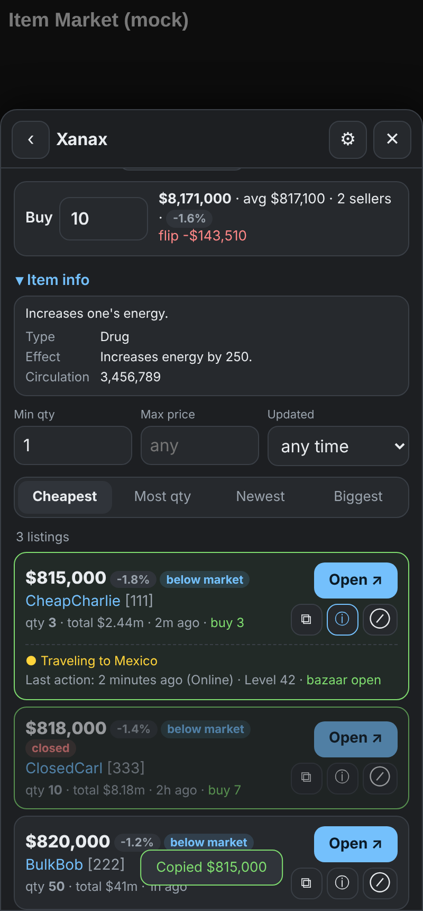
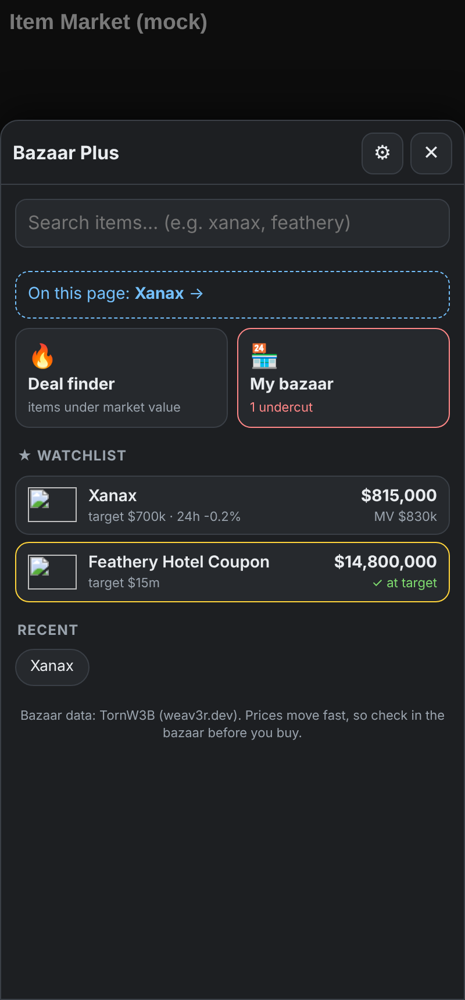
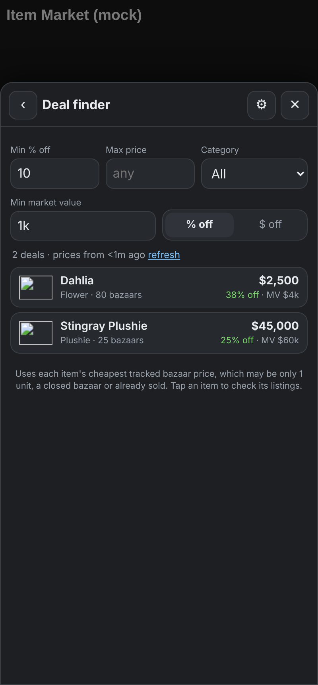
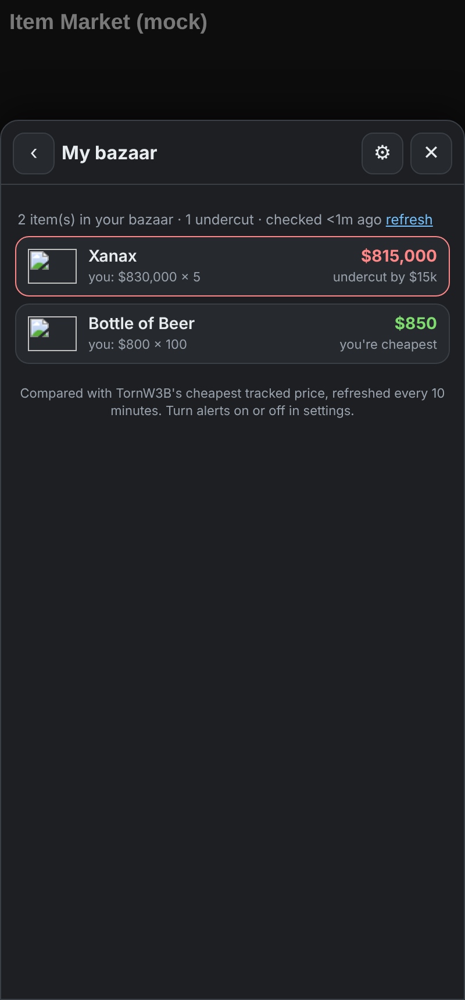
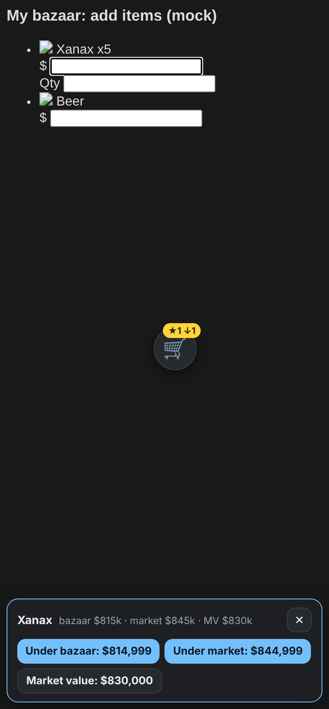
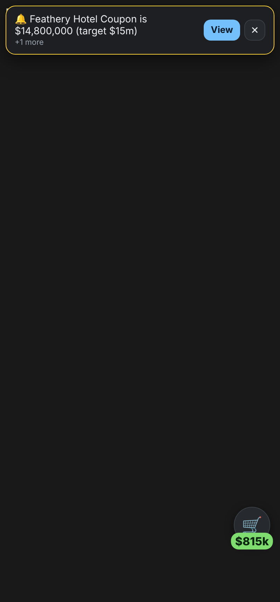

# Bazaar Plus

A Torn userscript for buying and selling through bazaars. It shows the cheapest bazaar listings for any item, finds deals, tracks prices, warns you when you're undercut, and helps you price your own items. It's built for **Torn PDA** and also works in Tampermonkey or Violentmonkey on desktop.

| Item | Details & sellers | Home |
|---|---|---|
|  |  |  |

| Deal finder | My bazaar | Price helper | Alert |
|---|---|---|---|
|  |  |  |  |

## Features

**Buying**
- **Search any item** and see every tracked bazaar selling it, cheapest first. You can also sort by most quantity, newest or biggest stack.
- **Filters:** minimum quantity, maximum price (`800k`, `1.5m` work), and how recently the listing was updated.
- **% vs market value** on every listing, plus a **below market** tag when it's cheaper than the Item Market.
- **Buy calculator:** enter a quantity to get the cheapest total, average price and which sellers to buy from.
- **Copy price:** ⧉ on any listing, or "copy" next to the lowest bazaar and Item Market prices.
- **Seller status** (ⓘ): shows whether the seller is OK, travelling, in hospital or in jail, plus their last action and whether their bazaar is open. Closed bazaars are dimmed and tagged automatically.
- **Deal finder:** every item whose cheapest bazaar price is below market value. Filter by % off, max price, category and minimum value, and sort by % or $ off.

**Selling**
- **Flip profit:** buy at the cheapest bazaar price and list $1 under the Item Market's lowest, minus the selling fee. It's shown per item and for the quantity in the calculator.
- **Price helper:** on your own bazaar and the Item Market's add-listing page, tap a price box and a bar shows the cheapest bazaar price, Item Market price and market value. Tap a button to type that price minus your undercut amount into the box. **It never submits anything**; you check and confirm yourself.
- **Undercut alerts:** every 10 minutes, compares your bazaar prices with the cheapest tracked price, and warns you when someone is cheaper. See it all under **My bazaar**.

**Tracking**
- **Price history:** the lowest price is saved on your device each time you view an item, and every 10 minutes for watched items. You get a 7, 30 or 120-day chart plus 24h and 7d change.
- **Watchlist with target prices.** A pop-up alert (with vibration) appears when a watched item drops to your target or you get undercut. Each alert shows once, and dismissing it shows the next one.
- **Item info:** description, effect, requirement, circulation and shop prices.
- **Item Market badge:** on an Item Market item page, the 🛒 button shows that item's lowest bazaar price.

**Other**
- **Draggable 🛒 button:** drag it anywhere. Its position is saved, and there's a reset in settings.
- **Open ↗** opens the seller's bazaar with the item outlined.
- Hide sellers (⊘), auto-hide your own bazaar, optional 30s auto-refresh, and refresh progress messages.

## Install (auto-updates)

**Install link:**

```
https://raw.githubusercontent.com/SarcasticGeekJr/torn-bazaar-plus/main/bazaar-plus.user.js
```

**Torn PDA**
1. Settings → Userscripts → **+**
2. Tap **Remote load/update** → **Configure**, paste the install link above and load it.
3. Injection time: **END**. Save, then reload Torn.
4. If it asks about an API key, tap **Add** to use your Torn PDA key, or **Set API Key** with a **Public** key.

When there's a new version, Torn PDA shows an update when the app starts. Tap to update. Don't edit the script on your phone, or Torn PDA stops updating it.

**Desktop (Tampermonkey):** open the install link above in your browser and click **Install**. Tampermonkey checks for updates on its own.

## API key

The key is optional. Without one you still get bazaar listings, filters, the calculator, copy, deal finder, watchlist and price history.

A **Public** key adds Item Market prices, flip profit, item info, seller status, open/closed bazaars, undercut alerts and Item Market prices in the price helper. The key is stored on your device and only sent to api.torn.com.

## Data and rules

- Bazaar data comes from [TornW3B (weav3r.dev)](https://weav3r.dev). It doesn't track $1 listings, and prices can be a few minutes old, so always confirm in the bazaar.
- Official Torn API: v2 `market/{id}/itemmarket`, `market/{id}/bazaar`, `torn/{id}/items`; v1 `user/{id}?selections=profile` and `user/?selections=bazaar`.
- **Item Market fee:** flip profit uses 5% by default. Check the real fee in Torn and change it in settings if it's different.
- The script reads data, displays it, and can type a price into a box when you tap a button. It never buys, lists or confirms anything, which keeps it within Torn's scripting rules.
